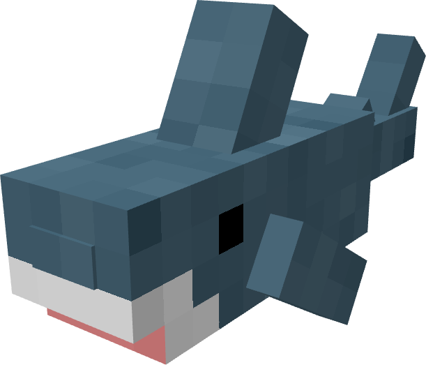

<p align="center">
  
</p>

<h1 align="center">Blåhaj Reborn</h1>

<p align="center">
  A squishy Blåhaj for Minecraft. Hold it, wear it on your head, place it, squish it.<br>
  <b>Do not squish the other one.</b>
</p>

<p align="center">
  <a href="https://github.com/iSweat-exe/Blahaj-Reborn/actions/workflows/build.yml"></a>
  <a href="LICENSE"></a>
  
  
  
  
</p>

---

### What is this?

Blåhaj Reborn adds the beloved shark plush to Minecraft, modelled and animated in Blockbench and rendered with
[GeckoLib](https://github.com/bernie-g/geckolib).

- **Blåhaj** – hold it, wear it on your head, or place it on the ground. Right-click a placed one to squish it,
  with a squish animation and a squeaky sound whose pitch changes every time.
- **A hitbox that fits the model** – the selection box follows the shark instead of a full cube, and rotates with it.
- **Creative tab** – every item of the mod lives in the *Blåhaj Reborn* tab.
- **Something else** – there is a second Blåhaj. Its name is hard to read. It comes with a warning.

> Spoilers ahead. If you want to be surprised, skip the next section.

<details>
<summary><b>The Void Blåhaj</b></summary>

<br>

Place it and squish it. Nothing happens for three seconds. Then it rises about ten blocks into the air and opens a
black hole that pulls in every entity (players excepted) and rips blocks out of the ground. The hole keeps growing,
collapses, and explodes with everything it swallowed, leaving a scorched crater. It is single use.

The screen glitches, distorts and shakes the whole time (shaders, camera shake, field of view, a darkened sky), and
there is an advancement waiting for those who witness it.

<p align="center"></p>

</details>

### Recipes

| Item | Recipe |
|---|---|
| Blåhaj | 3 light blue wool, 1 white wool, 1 pink dye, 1 string |
| Void Blåhaj | 4 diamonds, 4 eyes of ender, 1 Blåhaj |

### Supported versions

| Minecraft | Loader | Loader version | Requires |
|---|---|---|---|
| 26.3 | Fabric | 0.19+ | Fabric API, GeckoLib 5.5.7+ |
| 26.3 | NeoForge | 26.3.0.110+ | GeckoLib 5.5.7+ |
| 26.3 | Forge | 66+ | GeckoLib 5.5.7+ |

### Installation

1. Install a supported mod loader for Minecraft 26.3.
2. Download [GeckoLib](https://modrinth.com/mod/geckolib) for your loader (and [Fabric API](https://modrinth.com/mod/fabric-api) on Fabric).
3. Download the Blåhaj Reborn jar for your loader from the
   [Releases](https://github.com/iSweat-exe/Blahaj-Reborn/releases) page and drop it into your `mods` folder.

### Known issues

- **The Blåhaj is not positioned correctly in the player's hand.** When it is held, the arm is raised but the plush
  does not sit perfectly in it yet (third person), and the first-person view has not been adjusted. This will be fixed
  in the next update. See the `FIXME` in `HumanoidModelMixin.java` and the `thirdperson_*` / `firstperson_*` entries
  in `models/item/blahaj.json`.

Found something else? Please [open an issue](https://github.com/iSweat-exe/Blahaj-Reborn/issues).

### Compatibility

- **Shader packs** – tested with Iris 1.11.7, Sodium 0.9.2 and Complementary Reimagined. The black hole renders
  correctly; the sky darkening is replaced by an on-screen veil because shader packs control the sky.
- **Other mods** – no known conflicts. Mixins are only used for client visuals (camera, sky, fog, arm pose).

<p align="center"></p>

### Building from source

You need **JDK 25**. The project is a multi-module Gradle build:

| Module | Contents |
|---|---|
| `common` | All mod content: classes, assets, data, mixins. No loader code. |
| `fabric` | Fabric entrypoints and registration |
| `neoforge` | NeoForge entrypoints and registration |
| `forge` | Forge entrypoints and registration |

```bash
git clone https://github.com/iSweat-exe/Blahaj-Reborn.git
cd Blahaj-Reborn
./gradlew build
```

The jars end up in `<loader>/build/libs/`. To build a single loader, run `./gradlew :fabric:build` (or `:neoforge`,
`:forge`).

Run the game from your workspace:

```bash
./gradlew :fabric:runClient
./gradlew :neoforge:runClient
./gradlew :forge:runClient
```

Fabric also has an automated client test that boots a world and takes screenshots into
`fabric/build/run/clientGameTest/screenshots`:

```bash
./gradlew :fabric:runClientGameTest
./gradlew :fabric:runClientGameTest -Pshaders=true   # with Iris, Sodium and a shader pack
```

For the shader run, put a shader pack zip in `fabric/run-shaderpacks/` first.

### Contributing

Issues and pull requests are welcome. Please keep new code loader independent (put it in `common`) and register new
content through `BlahajRegistry`. The CI builds all three loaders for every pull request.

### Credits

- [GeckoLib](https://github.com/bernie-g/geckolib) by Tslat and contributors.
- Sound effects: see [CREDITS.md](CREDITS.md).
- Blåhaj is a plush designed by IKEA. This is an unofficial fan project and is not affiliated with IKEA.

### License

Blåhaj Reborn is released under the [MIT License](LICENSE).
Sound effects keep their own licenses, listed in [CREDITS.md](CREDITS.md).
